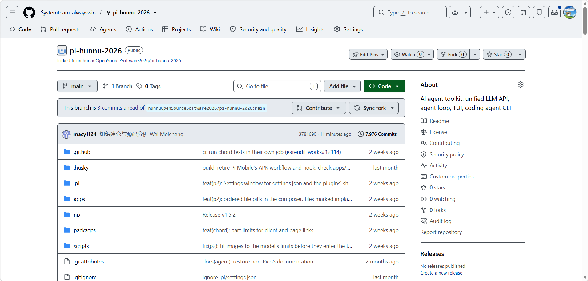
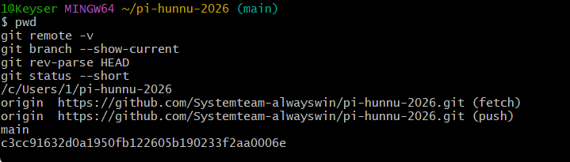
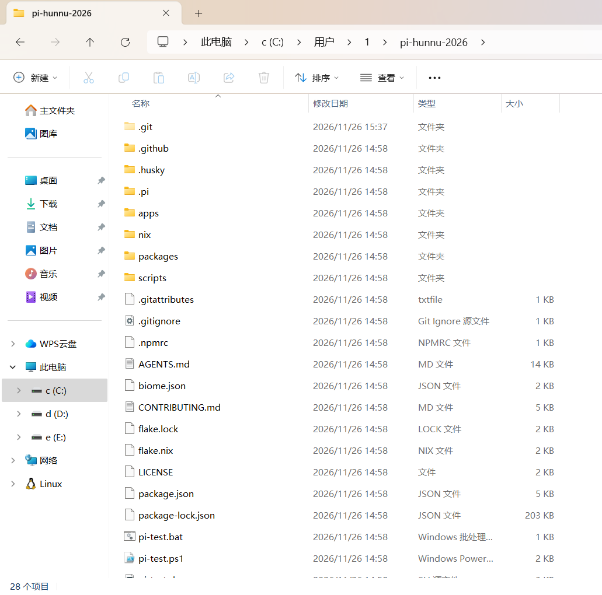
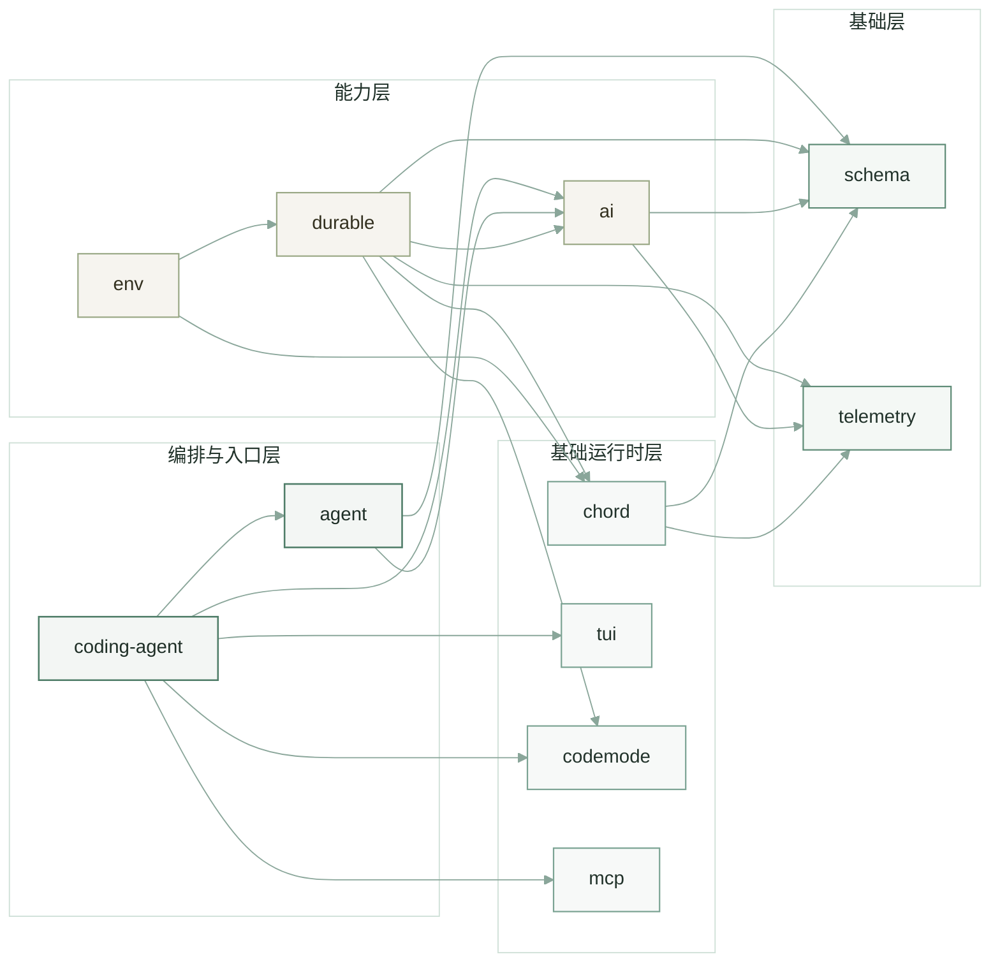

# 实践课2：组织建仓与源码分析

## 一、源码获取

**组织仓库截图：**



**clone 后的仓库信息（S1）：**



**本地源码目录截图：**



## 二、模块分析

### 2.1 构建顺序

根 `package.json` 的 `build` 按以下顺序串联执行各模块自身的 `npm run build`：

```text
telemetry → schema → chord → tui → codemode → mcp → ai → durable → env → agent → coding-agent
```

### 2.2 模块分析表

| 子文件夹           | 代码主要实现什么功能                                                        | 本模块 build 执行什么、生成什么                                                                                                                  | 直接依赖哪些内部模块                                   | 依据文件或代码位置                                                                                                          |
| -------------- | ----------------------------------------------------------------- | ------------------------------------------------------------------------------------------------------------------------------------ | -------------------------------------------- | ------------------------------------------------------------------------------------------------------------------ |
| `telemetry`    | 中立遥测契约、类型化指标、内存适配器                                                | `tsc -p tsconfig.build.json` 编译到 `dist/`，产出 `index`、`render`、`testing` 入口                                                            | 无                                            | `packages/telemetry/package.json`；`src/index.ts`                                                                   |
| `schema`       | 不使用 eval 的 JSON Schema 校验器，支持 draft 2020-12 与 draft 7             | `tsc -p tsconfig.build.json` 编译到 `dist/`，产出 `index`、`formats` 入口                                                                     | 无                                            | `packages/schema/package.json`；`src/index.ts`                                                                      |
| `chord`        | 跨进程对象运行时、文档/插件热重载/HTTP/Workers/客户端面                               | `tsc -p tsconfig.build.json` 编译到 `dist/`，产出 context、delta、sqlite、http、workers、plugins、app、web、tui、sync 等多入口                          | `schema`、`telemetry`                         | `packages/chord/package.json` → `dependencies`；`src/`                                                              |
| `tui`          | 终端用户界面库，差分渲染，组件与主题                                                | `tsc -p tsconfig.build.json` 编译到 `dist/`；另有 `build:native:*` 编译各平台原生 `.node`                                                         | 无                                            | `packages/tui/package.json`；`src/index.ts`                                                                         |
| `codemode`     | 沙箱化 JavaScript 执行环境，被注入工具是唯一可调用能力                                 | `tsc -p tsconfig.build.json` 编译到 `dist/`，产出 `index`、`declarations`、`source`、`portable`、`cloudflare`、`worker` 入口                      | 无                                            | `packages/codemode/package.json`；`src/index.ts`                                                                    |
| `mcp`          | 独立的 MCP 客户端，含 OAuth 与测试工具                                         | `tsc -p tsconfig.build.json` 编译到 `dist/`，产出 `index`、`oauth`、`testing` 入口                                                             | 无                                            | `packages/mcp/package.json`；`src/index.ts`                                                                         |
| `ai`           | 统一 LLM API 层：模型发现与 provider 配置，对接 OpenAI、Anthropic、Gemini、Bedrock | `generate-models` 生成模型目录 → 校验数据 → `tsc` 编译 → 拷贝 `providers/data`；产物在 `dist/`，含 CLI `dist/cli.js`                                     | `schema`、`telemetry`                         | `packages/ai/package.json` → `dependencies`；`src/`                                                                 |
| `durable`      | 持久化会话、任务与文档运行时：存储、工具、图片处理、工具搜索、codemode 集成                        | `tsc -p tsconfig.build.json` 编译到 `dist/`，产出 `index`、`env`、`codemode`、`tool-search`、`tools`、`images`、`storage/*` 入口                   | `chord`、`ai`、`codemode`、`schema`、`telemetry` | `packages/durable/package.json` → `dependencies`；`src/`                                                            |
| `env`          | SSH 远端执行环境与 Rust daemon                                           | `tsc` 编译 TS 到 `dist/`；`build:daemon` 用 cargo 编译 Rust 守护进程；产物在 `dist/`、`bin/`                                                         | `chord`、`durable`                            | `packages/env/package.json` → `dependencies`；`src/index.ts`                                                        |
| `agent`        | Agent 循环、工具执行、事件流                                                 | `tsc -p tsconfig.build.json` 编译到 `dist/`，产出 `dist/index.js`、`dist/index.d.ts`                                                        | `ai`、`schema`                                | `packages/agent/package.json` → `dependencies`；`src/agent-loop.ts`、`src/agent.ts`、`src/types.ts`                   |
| `coding-agent` | `pi`<br />CLI、会话/扩展/工具/RPC                                        | `build:unbundled`（`tsc` 编译 + 拷贝资源）→ `build-coding-agent-bundle.mjs` 打包；CLI 入口 `dist/bundle/cli.js`，RPC 入口 `dist/bundle/rpc-entry.js` | `agent`、`ai`、`codemode`、`mcp`、`tui`          | `packages/coding-agent/package.json` → `dependencies`；`src/core/agent-session.ts`、`src/extensions/mcp/`、`src/cli/` |

### 2.3 依赖关系图

箭头方向：使用方 → 被依赖方；实线为 `dependencies` 声明的直接运行时内部依赖。

依赖口径：表中“直接依赖”仅统计 `dependencies` 声明的内部运行时模块。`chord` 的 `peerDependencies`（esbuild、react、ws）标记为 optional，属可选对等依赖；各模块 `devDependencies`（vitest、类型定义等）仅用于开发与测试，二者均不计入下图。

**层级划分依据**：按抽象层次与被依赖程度自左向右分为四层——

1. **编排与入口层**：`coding-agent`、`agent`，面向最终用户组织会话、工具与界面。
2. **能力层**：`ai`、`durable`、`env`，在基础层之上组合出 LLM 通信、持久化会话、远程执行等业务能力。
3. **基础运行时层**：`chord`、`tui`、`codemode`、`mcp`，各自封装一类独立基础能力（对象运行时、终端界面、沙箱执行、协议客户端）。
4. **基础层**：`schema`、`telemetry`，不依赖任何内部模块，提供通用契约、校验与遥测基础类型。



图源文件：`dependency.mmd`

### 2.4 问题回答

**1. 根目录与子模块的** `npm run build` **分别读取什么配置、执行什么工作？**

根目录的 npm run build 读取的是仓库根目录的 package.json。它本身不编译代码，只按固定顺序串联执行各模块的 npm run build。  
子模块的 npm run build 读取的是各自文件夹里的 package.json 中 scripts.build，多数还配合 tsconfig.build.json。大多数模块执行 tsc -p tsconfig.build.json，即用 TypeScript 编译器把 src/ 编译到 dist/，生成 .js 和 .d.ts 声明文件（如  telemetry、schema、chord、tui、codemode、mcp、durable、env、agent，依据 packages/telemetry/package.json:31）。

**2. 构建顺序和模块依赖有什么关系？相邻构建的模块是否一定互相依赖？**

两者大致相关但不等同。根目录的顺序基本遵循"被依赖者先建"：例如 telemetry、schema 在源码里没有依赖任何内部包，排在最前；而 coding-agent 依赖最多（agent、ai、codemode、mcp、tui 等），排在最后；agent 依赖 ai 和 schema，也排在它们之后。这样后建的模块编译时能找到先建模块产出的 dist。  
但相邻构建的模块不一定互相依赖。比如 tui 紧接着 codemode 构建，但 tui 的源码没有 import codemode；mcp 和 ai 相邻，mcp 也没有直接依赖 ai。这个顺序更像是仓库维护者按依赖深度大致排序后固定下来的一条清单，而不是严格的拓扑排序结果。判断依赖要看源码里的 import，不能只看构建顺序。

**3. 选择一条涉及至少三个模块的依赖路径，说明这些模块如何分工。**

路径：coding-agent → agent → ai。

分工说明：

- coding-agent 是最上层的完整编程助手应用/CLI，负责把命令行界面、工具、RPC、扩展等组装起来给用户使用；它调用 agent 来真正执行"有状态的智能体循环"，也用到 mcp、tui、codemode。
- agent 是中间层，实现"有状态的智能体"：管理对话状态、执行工具调用、流式输出事件；它本身不直接跟大模型厂商打交道，而是把这部分交给 ai（README 写明 "Built on @earendil-works/pi-ai"）。
- ai 是底层统一的 LLM 接口层，封装各家模型供应商、自动鉴权、token 与费用统计、上下文持久化等；它再往下只依赖 schema（做 JSON Schema 校验）和 telemetry（记录运行指标）。
