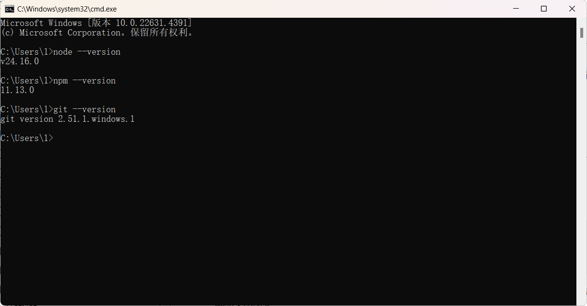
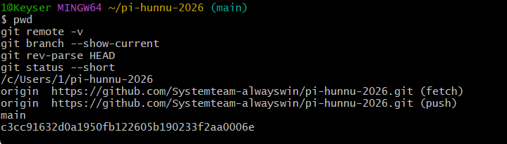
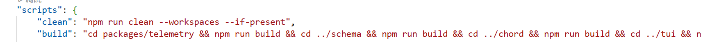
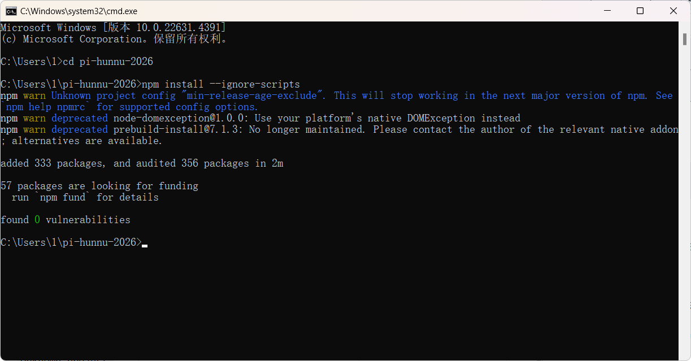
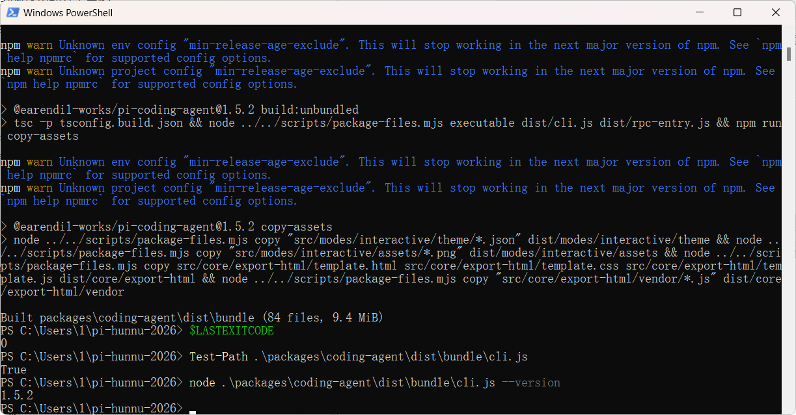
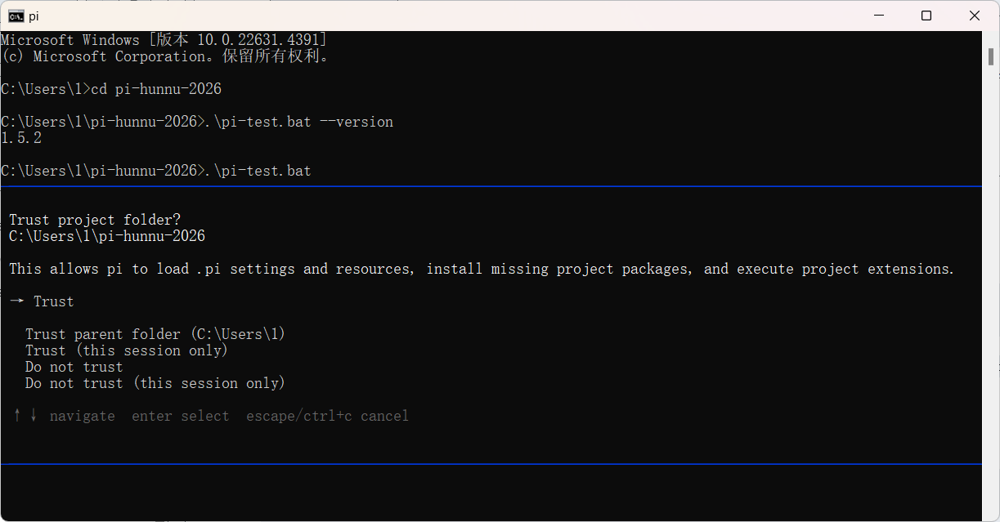
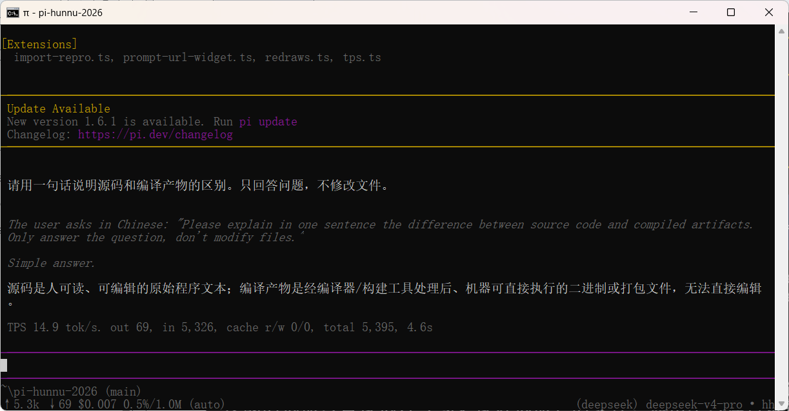

# 实践课3：Pi Agent 源码安装与编译 实验报告

## 任务一　实验准备：检查和安装开发工具

### 1.1 检查现有环境（截图要求 S1）

在 PowerShell / CMD 中逐条执行 `node --version`、`npm --version`、`git --version`，检查三个工具是否可用。

```powershell
node --version
npm --version
git --version
```



*图 S1：终端中显示的 Node.js、npm、Git 实际版本。*

本次实测结果：

| 工具              | 实际版本             | 本次用途                        |
| --------------- | ---------------- | --------------------------- |
| Node.js         | v24.16.0         | 运行 JavaScript 程序和项目开发脚本     |
| npm             | 11.13.0          | 安装依赖、执行项目脚本（随 Node.js 一同安装） |
| Git for Windows | 2.51.1.windows.1 | 下载和管理源码                     |

**我的理解**：第一次实践课里 `pi` 能运行，并不代表当前终端一定能找到这三个工具，所以要先逐条验证。根 `package.json` 声明的最低版本是 `>=22.19.0`，但工作区中个别依赖（如 `@earendil-works/gondolin`）要求更高的 Node 版本，旧环境下安装会出现 `EBADENGINE` 警告。为统一环境、避免这类警告，本次使用 Node.js 24 LTS，它同时满足根项目和依赖的要求；注意这并不是把根项目的 `engines` 改成了 `>=24`。npm 随 Node.js 官方安装程序一起装上，无需单独安装。版本号按本机实际结果记录即可，不必照抄教师截图里的补丁版本。

---

## 任务二　下载课程仓库源码

### 2.1 建立实验目录并下载源码

```powershell
git clone --branch main <本小组组织内的仓库地址>
cd pi-hunnu-2026
```

### 2.2 确认源码来源和版本（截图要求 S2）

```powershell
Get-Location
git remote -v
git branch --show-current
git rev-parse HEAD
git status --short
```



*图 S2：当前目录、`origin` 远端地址、当前分支和完整提交编号。*

---

## 任务三　阅读配置，确认安装与编译的依据

### 3.1 查看关键配置（截图要求 S3）

用编辑器打开仓库根目录，查看 `README.md`、`package.json`、`package-lock.json`、`packages/` 以及 `packages/coding-agent/package.json`。其中两处关键定义如下。

**engines.node 定义：**


*图 S3-a：根 `package.json` 第 69–70 行的 `engines` 字段，值为 `>=22.19.0`。*

**scripts.build 定义：**



*图 S3-b：根 `package.json` 的 `scripts.build`，用 `&&` 依次进入各子包执行构建。*

### 3.2 问题1：Node.js 版本要求在哪里？

**答**：写在仓库根目录 `package.json` 的 `engines.node` 字段里，值为 `>=22.19.0`。

### 3.3 问题2：`npm run build` 实际从哪里读取命令？

**答**：`npm run build` 从 `package.json` 的 `scripts` 里读出自定义命令：根脚本负责串联顺序，真正的构建动作在各子包脚本里。

---

## 任务四　安装项目依赖

### 4.1 执行安装（截图要求 S4）

确认当前目录包含根 `package.json`，执行：

```powershell
npm install --ignore-scripts
```



*图 S4：安装结束时的输出，包含安装汇总、弃用提示和审计结果。*

安装结果：`added 333 packages, and audited 356 packages in 2m`，`found 0 vulnerabilities`。

---

## 任务五　本地编译与构建产物验证

### 5.1 首次构建：执行 `npm run build`

仍在仓库根目录执行：

```powershell
npm run build
```

首次构建需要联网获取**模型目录数据**（模型列表、能力等配置数据），**不是下载大模型权重**。从日志可以观察到完整的调用链：根 `scripts.build` → 各子包 `npm run build` → 多数子包调用 `tsc -p tsconfig.build.json`，`pi-ai` 包则调用 `node catalog/generate.ts --strict` 联网生成模型目录数据。这与任务三的分析一致，也验证了"根脚本 → 子包脚本 → 编译器/生成脚本"的三层关系。

本次首次构建在 `pi-ai` 的 `generate-models` 阶段因连接上游接口超时而失败（详见"遇到的困难"第 2、3 条）。按作业设计，模型数据只需联网成功生成一次并落盘，之后即可用离线构建复用数据完成编译：

```powershell
npm run build:offline
```

### 5.2 检查并运行构建产物（截图要求 S5）

```powershell
$LASTEXITCODE
Test-Path .\packages\coding-agent\dist\bundle\cli.js
node .\packages\coding-agent\dist\bundle\cli.js --version
```



*图 S5：构建末尾 `Built packages\coding-agent\dist\bundle (84 files, 9.4 MiB)`、退出码 `0`、`Test-Path` 为 `True`、版本号 `1.5.2` 在同一屏中。*

**我的理解**：`dist` 保存构建产物，入口来自 CLI 包的 `bin.pi` 配置。以后修改程序应改 `src` 下的源码再重新构建，直接改 `dist` 里的文件会在下次构建时被覆盖。另外要注意命令顺序：`node ...cli.js --version` 会覆盖 `$LASTEXITCODE`，所以要先打印构建退出码，再跑版本号命令。只看到某个子包打印成功、或只看到版本号，都不能证明根构建整体成功；只有退出码 `0`、产物存在且能跑出版本号三者齐全才算成功。后续重复构建才用 `npm run build:offline`；它仍会重新编译相关包，但复用已有模型目录数据，不要把它当成首次数据初始化的替代命令。

---

## 任务六　启动本地源码版本并完成一次会话

### 6.1 先验证源码入口

```powershell
.\pi-test.bat --version
```

输出 `1.5.2`，与源码版本一致。这个脚本名字带 `test`，但它是运行**本地源码**的入口，不是执行整个项目的测试套件；当前版本由 `.bat` 调用 `.ps1`，由 Node.js 加载源码解析器并运行 `packages/coding-agent/src/cli.ts`。

### 6.2 启动交互界面并会话

```powershell
.\pi-test.bat
```

启动后首先出现项目信任提示（图 S6-a）：



*图 S6-a：`.\pi-test.bat --version` 输出 `1.5.2`、`.\pi-test.bat` 启动命令，以及 `Trust project folder?` 提示。*

`Trust project folder?` 是 Pi 的项目信任机制，用于确认是否加载项目本地的 `.pi` 设置、资源与扩展。本次是自己的课程仓库，我选择 `Trust` 继续，因此界面上方出现了 `[Extensions]` 一行，显示加载了 `repro.ts`、`prompt-url-widget.ts`、`redraws.ts`、`tps.ts` 等项目内扩展模块。启动界面还提示有新版本 1.6.1 可用——这是全局发布版的更新提示，不影响本次运行的本地源码版本 1.5.2。

本次发送的问题与模型回复（图 S6-b）：

> **我的提问**：请用一句话说明源码和编译产物的区别。只回答问题，不修改文件。
>
> **模型回复**：源码是人可读、可编辑的原始程序文本：编译产物是经编译器/构建工具处理后、机器可直接执行的二进制或打包文件，无法直接编辑。



*图 S6-b：Pi 界面、本人提示词、实际模型回复，底部可见当前目录 `\pi-hunnu-2026 (main)` 与所用模型。*

**我的理解**：

1. **如何确保运行的是本地源码**：用 `.\pi-test.bat` 而不是直接输入 `pi`。直接输入 `pi` 可能启动第一次实践课安装的**全局版本**，无法单独证明运行的是刚下载的源码；`.\pi-test.bat` 从 `src/cli.ts` 直接加载，界面底部显示 `\pi-hunnu-2026 (main)`，证明工作目录就是本次的源码仓库。
2. **用户配置是共用的**：本地源码版与已安装的 Pi 共用 `~/.pi/agent` 配置目录，所以之前已完成登录且凭据有效的同学通常无需再次 `/login`。这表示复用了用户配置，**并不表示运行的是全局安装版本**。
3. **两个入口的适用场景**：`.\pi-test.bat`（源码入口）适合边改边看，用于验证源码改动、调试开发；`dist/bundle/cli.js`（编译产物入口）适合验证构建结果，确认打包后的程序能独立运行。退出 Pi（输入 `/quit`，或空输入框时按 `Ctrl+D`）返回 PowerShell 后，可以运行 `node .\packages\coding-agent\dist\bundle\cli.js` 与源码版做比较。
4. **模型调用与编译是两件事**：本次实际收到了模型回复。若模型调用失败，应把"本地程序启动成功"和"模型回复失败"分别记录，不能把它算作编译失败。

---

## 遇到的困难与解决过程

### 困难1：首次构建在联网获取模型目录数据时连接超时

现象：执行 `npm run build`，前面 telemetry、schema、chord、tui、codemode、mcp 等包的 `tsc` 都正常通过，到 `pi-ai` 的 `generate-models` 阶段报错：

```
Fetching models.dev catalog...
Failed to fetch models.dev catalog: [TypeError: fetch failed]
  [cause]: ConnectTimeoutError: Connect Timeout Error (... timeout: 10000ms) {
    code: 'UND_ERR_CONNECT_TIMEOUT'
  }
npm error Lifecycle script `generate-models` failed with error:
```

分析与排查：这不是编译错误，而是**联网获取模型目录数据失败**。前面 6 个子包都用 `tsc` 编译通过，说明源码和依赖没问题。进一步观察发现，终端里 npm 能正常安装依赖，说明网络代理本身是通的；但项目脚本用的是 Node 内置的 `fetch`（undici），它**默认不读取** `HTTP_PROXY` / `HTTPS_PROXY` 环境变量，因此脚本仍走直连，到境外接口时 10 秒内连不上就超时。这也解释了为什么"npm 装得下来、数据却拉不到"。

解决：在 PowerShell 中设置 Node 的环境变量代理开关后再执行：

```powershell
$env:NODE_USE_ENV_PROXY = "1"
npm run build
```

### 困难2：根构建每次重新拉全部数据源，代理波动导致反复超时

现象：即使数据已经生成过，再次执行完整 `npm run build` 时，`pi-ai` 的 `build` 脚本仍是 `generate-models && build:offline`，会**重新联网拉取全部上游数据源**。代理不稳定时，每次失败的源都不一样：一次是 `models.dev`，一次是 `OpenRouter models`，都是 `UND_ERR_CONNECT_TIMEOUT`。这说明问题在网络波动，而不是代码或操作，继续重试只是在碰运气。

解决：利用作业提供的 `build:offline`，既然模型目录数据已经成功生成一次并落盘，就不必再联网。在仓库根目录执行：

```powershell
npm run build:offline
```

该命令先 `check:model-data` 校验已有数据，再重新编译全部子包，最终输出 `Built packages\coding-agent\dist\bundle (84 files, 9.4 MiB)`，退出码为 `0`，并通过了 `Test-Path` 与版本号验证（图 S5）。

经验总结：模型目录数据只在首次需要联网生成一次；生成成功后用 `build:offline` 复用数据，既符合作业设计，也能避开网络波动，让构建结果稳定可复现。满屏的 `Unknown project config "min-release-age-exclude"` 来自仓库的 `.npmrc`，只是 npm 的版本兼容提示，无害，也不是失败原因。

### 困难3：启动 Pi 时的项目信任提示

现象：`.\pi-test.bat` 启动后弹出 `Trust project folder?` 选择界面，而不是直接进入对话。处理：这是 Pi 的项目信任机制，用于确认是否加载项目本地的 `.pi` 设置与扩展；本次是自己的课程仓库，选择 `Trust` 继续，随后正常完成会话（图 S6-a、S6-b）。如果不想让 Pi 记住信任，可在该界面选 `Do not trust`；也可以用 `/trust` 命令重新打开选择器，状态保存在 `~/.pi/agent/trust.json`（`true` = 信任，`false` = 不信任，删掉条目 = 每次询问），改动后需重启 Pi 生效。退出 Pi 用 `/quit` 或空输入框时按 `Ctrl+D`。


