# 实践课1：Pi Agent 安装与使用 实验报告

## 任务一　本地安装并启动 Pi

**验收截图 S1**

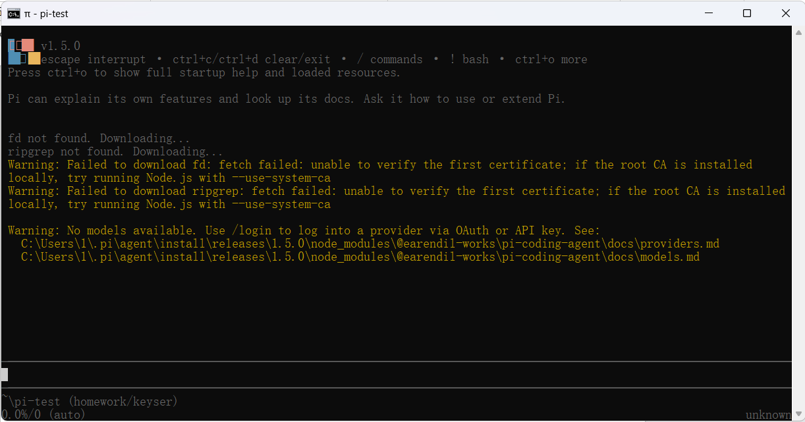

*图 S1  Pi v1.5.0 已启动，当前目录 `~\pi-test (homework/keyser)`；底部提示 `No models available`。*

---

## 任务二　配置模型并完成一次会话

**验收截图 S2**

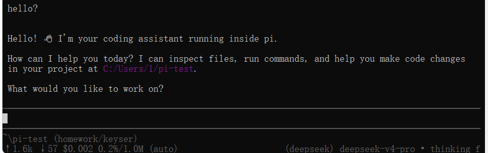

*图 S2  发出提示词 `hello?`，模型返回问候与能力说明；底部显示当前模型 `(deepseek) deepseek-v4-pro`。*

---

## 任务三　切换模型与思考级别

**验收截图 S3**

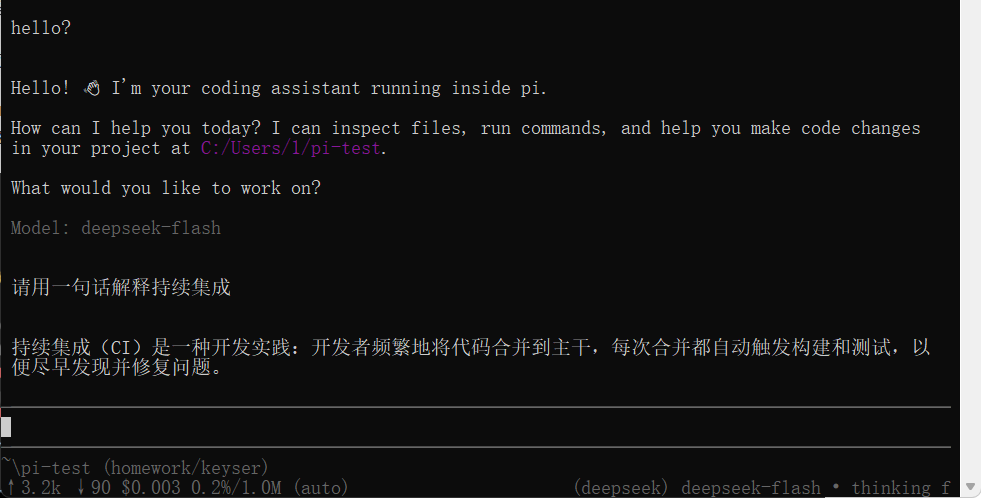

*图 S3-1  上半部分为切换前的 `deepseek-v4-pro` 会话，下半部分显示 `Model: deepseek-flash` 及切换后的会话，状态栏变为 `deepseek-flash`。*

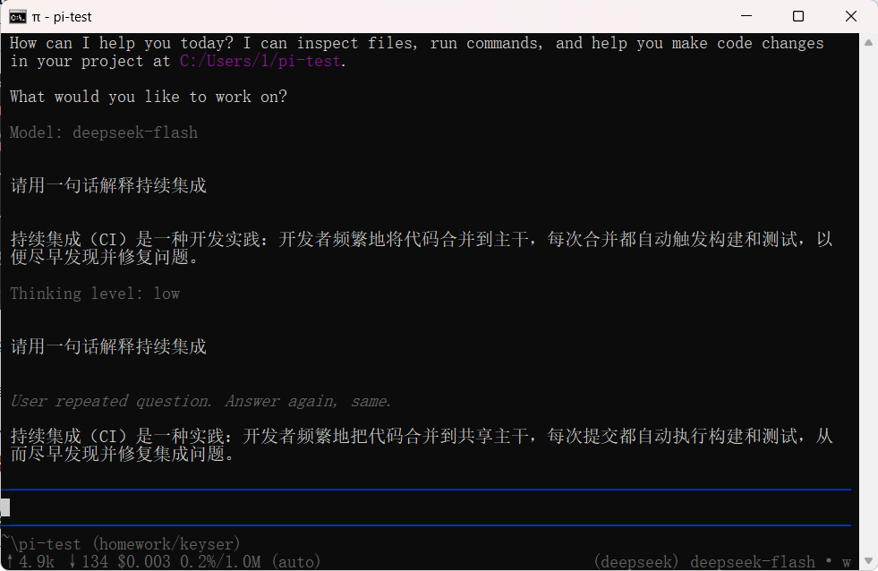

*图 S3-2  显示 `Thinking level: low`，切换后重新提问，模型正常回复。*

**结果说明**

| 项目   | 切换前               | 切换后              |
| ---- | ----------------- | ---------------- |
| 模型   | `deepseek-v4-pro` | `deepseek-flash` |
| 思考级别 | 默认（auto 状态栏）      | `low`            |

选择理由：`deepseek-flash` 响应更快，适合这类一句话解释的简单问题；思考级别调至 `low` 以减少等待和用量。思考级别是模型的推理设置，不是更换模型，也不是显示/隐藏思考文本；高思考级别不保证每次答案更好。切换后模型均能正常作答。

---

## 任务四　引用代码并粘贴小图片

### A　使用 @ 引用代码文件

**验收截图 S4**

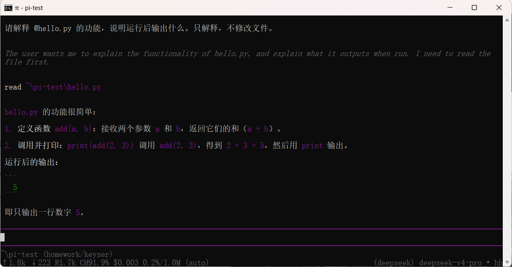

*图 S4-1  本次使用的原始小图片，供核对识别结果。*

### B　粘贴小图片并测试

**原始测试图片**（约 200×200，黄色六角星 + 蓝色数字 929）：

*图 S4-2  本次使用的原始小图片，供核对识别结果。*

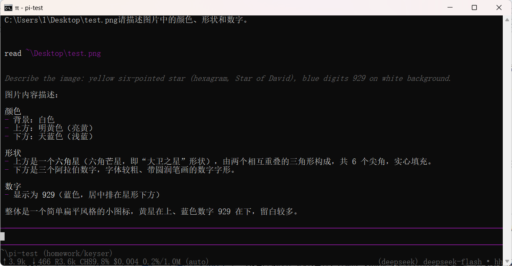

*图 S4-3  已附加图片的提示、问题和实际回复。*

---

## 任务五　安装并使用一个插件

**选用的插件**：`pi-web-access`（来源：<https://pi.dev/packages>）  
**作用**：为 Pi 增加联网抓取网页内容的能力（`fetch_content` / `fetch` 工具）。

**验收截图 S6**

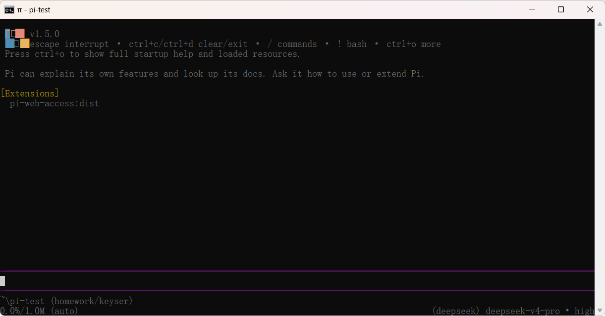

*图 S6-1  退出原会话后单独运行 `pi`，启动信息 `[Extensions]` 区域显示 `pi-web-access:dist`。*

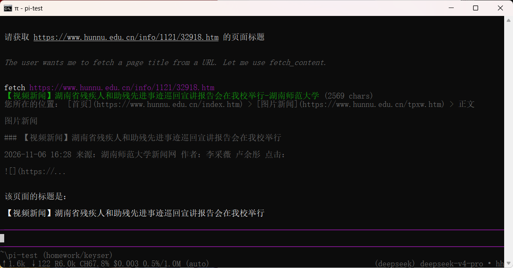

*图 S6-2  发出「请获取 <https://www.hunnu.edu.cn/info/1121/32918.htm> 的页面标题」，Pi 调用 `fetch_content` / `fetch` 工具并给出标题。*

---

## 任务六　让 AI 安装一个 PPT Skill

### 验收截图 S7 —— 目录结构

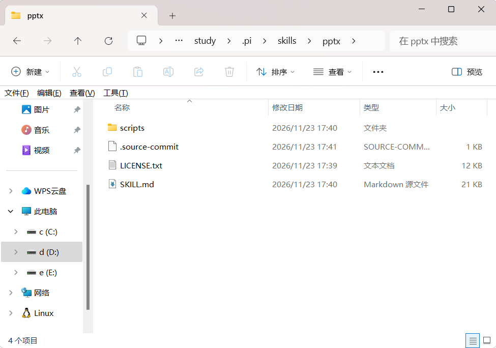

*图 S7-1  路径 `D:\projects\study\.pi\skills\pptx`，可见 `scripts`、`LICENSE.txt`、`SKILL.md` 和记录 commit 的 `.source-commit`。*

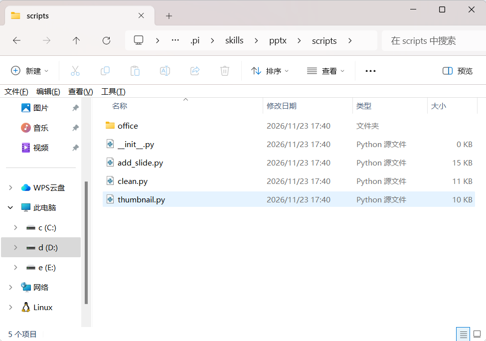

*图 S7-2  `scripts` 目录内可见 `office` 文件夹及 `add_slide.py`、`clean.py`、`thumbnail.py`、`__init__.py`，证明复制的是完整 Skill 目录而非仅 SKILL.md。*

### 验收截图 S8 —— 启动发现与实际调用

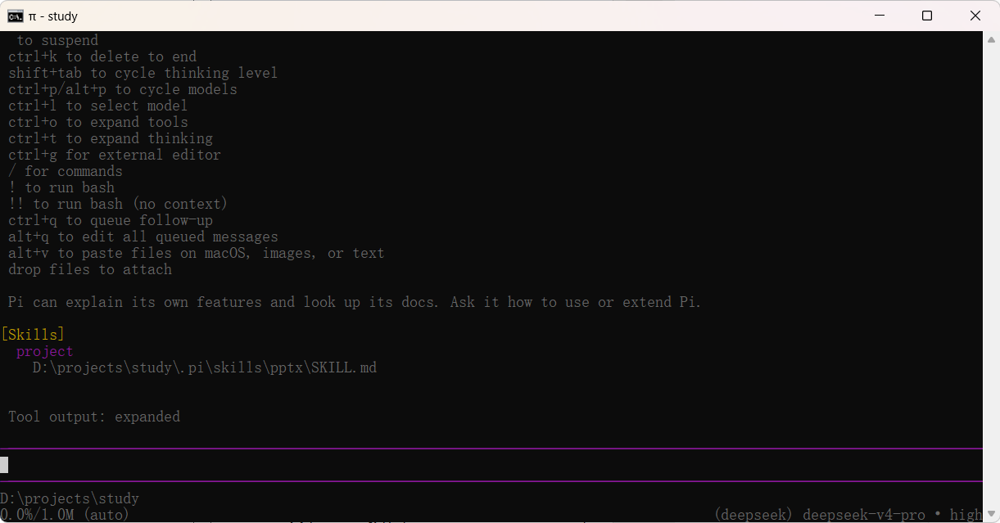

*图 S8-1  在 `D:\projects\study` 重新启动 Pi，`Ctrl+O` 的资源列表中 `[Skills] project` 显示 `D:\projects\study\.pi\skills\pptx\SKILL.md`，工作目录为 `D:\projects\study`。*

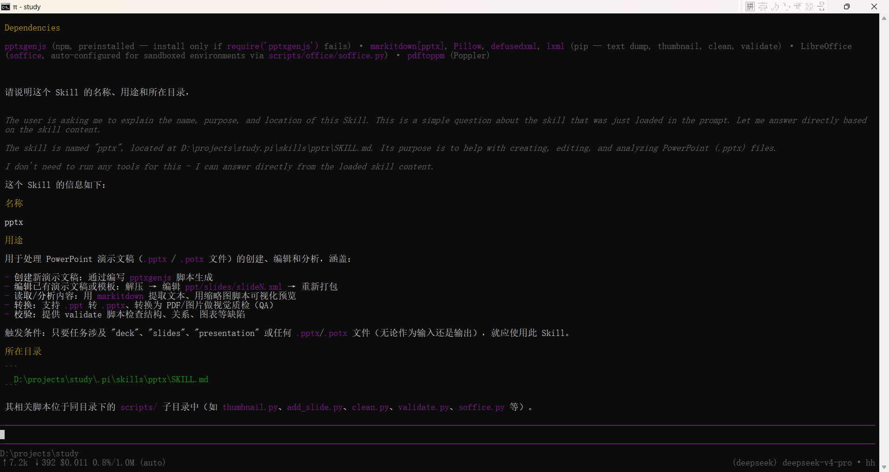

*图 S8-2  调用 `/skill:pptx` 后，Pi 依据加载的技能内容给出回复：名称 `pptx`、用途（创建、读取、编辑 PowerPoint `.pptx`/`.potx` 文件）、所在目录 `D:\projects\study\.pi\skills\pptx\SKILL.md`。*

---

## 实验中遇到的问题

1. **Windows git 证书校验失败**：直接 `git clone` 报 `CRYPT_E_NO_REVOCATION_CHECK`；改用 GitHub REST API（tree 递归清单 + raw 文件下载）完成 Skill 目录拉取。
2. **辅助工具下载警告**：Pi 首次启动下载 `fd`、`ripgrep` 时出现证书警告，不影响启动与会话。
3. **WSL bash 不可用**（教师演示环境）：`execvpe(/bin/bash) failed` 导致终端工具失败，需改用可用的 shell 路径。
4. **模型与思考级别**：`deepseek-flash` 对重复提问会直接复述「Answer again, same」，属模型行为，不影响切换验证。
   ---
